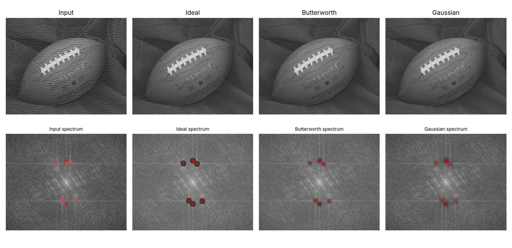
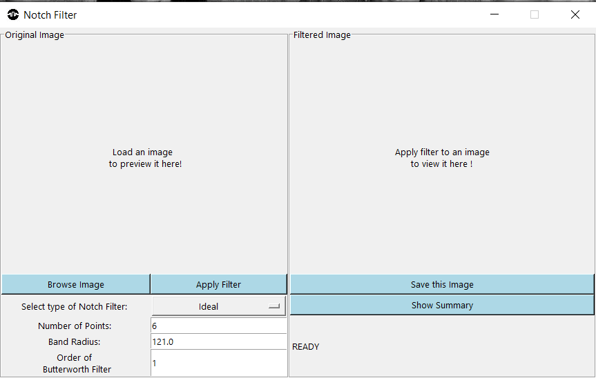
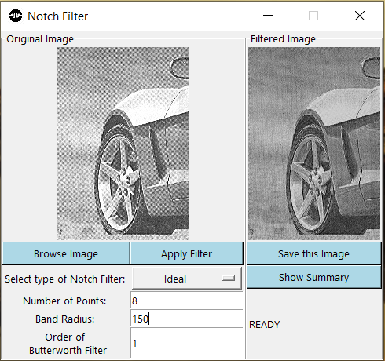
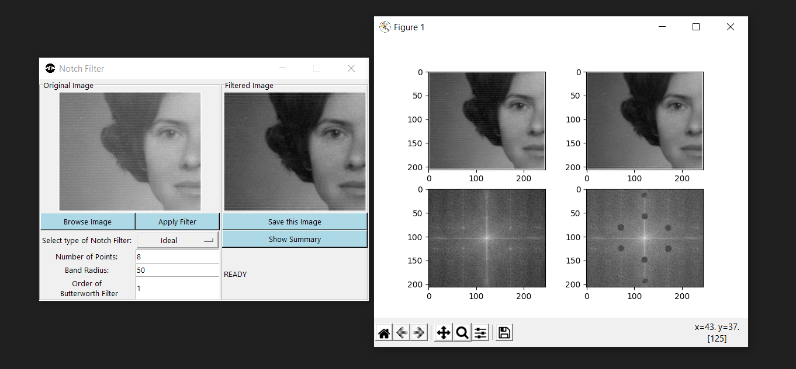
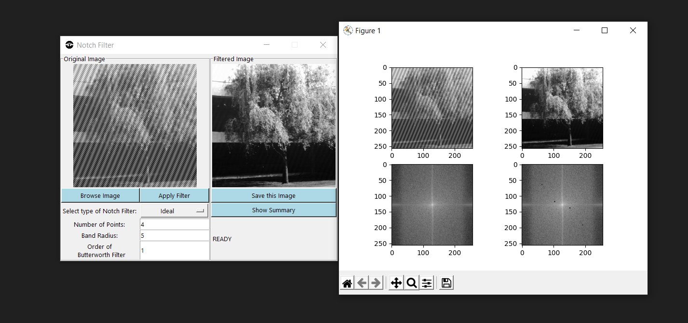
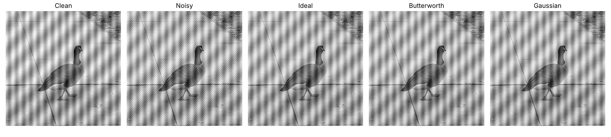
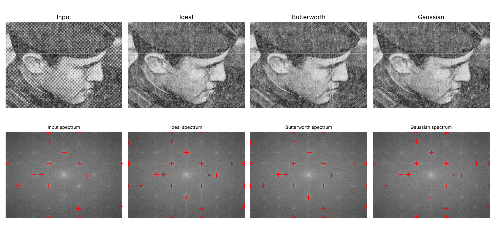

# Notch Filters for Periodic Noise Removal

Remove stripes, grids and moiré patterns from images by suppressing only the noise
frequencies in the Fourier domain. Three notch-reject filters are implemented:

| Filter | Character |
|---|---|
| **Ideal** | hard cut-off, strongest rejection, can ring |
| **Butterworth** (order *n*) | smooth transition, ringing falls as *n* gets smaller |
| **Gaussian** | smoothest, no ringing, gentlest rejection |

Use it three ways: as a **Python library**, from the **command line**, or through an
interactive **GUI** where you click the noise spikes on the spectrum.

<p align="center">
  
</p>

*Top: image and result of each filter. Bottom: log-magnitude spectrum; red `+` marks the
automatically detected noise spikes (and their mirror images) that were notched out.*

> Course project (Digital Image Processing) by **Rohit Shaw (23BCE7212)** and
> **Yash Bhardwaj (23BEC7036)**. Slides: [`docs/Notch_Filters_for_Periodic_Noise_Removal.pptx`](docs/Notch_Filters_for_Periodic_Noise_Removal.pptx).
> Based on [imdeep2905/Notch-Filter-for-Image-Processing](https://github.com/imdeep2905/Notch-Filter-for-Image-Processing)
> by Deep Raval (MIT) - see [What's new](#whats-new-in-v2) for what was changed.

## Why notch filters?

Periodic noise (electrical interference, scanner/sensor faults, halftone printing) shows up
as a handful of bright, symmetric **spikes** in the 2-D Fourier spectrum. Mean/median filters
blur the picture and cannot remove such patterns cleanly; a notch filter zeros out just
those spikes and leaves the rest of the spectrum alone.

```
image -> FFT -> shift DC to centre -> pick noise spikes -> multiply by notch mask
      -> inverse shift -> inverse FFT -> real part -> cleaned image
```

### Filter equations

For each selected spike `(u_k, v_k)` the mask also notches its mirror `(-u_k, -v_k)`.
`D_k`, `D_-k` are distances from `(u, v)` to the two, `D0` is the notch radius (pixels)
and `n` the Butterworth order; the product runs over all spike pairs.

```
Ideal        H = 0 if D_k <= D0 or D_-k <= D0, else 1
Butterworth  H = prod  1/(1 + (D0/D_k)^2n) * 1/(1 + (D0/D_-k)^2n)
Gaussian     H = prod  (1 - exp(-D_k^2 / 2 D0^2)) * (1 - exp(-D_-k^2 / 2 D0^2))
```

## Installation

```bash
git clone https://github.com/<your-username>/Notch-Filter-for-Image-Processing.git
cd Notch-Filter-for-Image-Processing
python -m venv .venv && source .venv/bin/activate   # Windows: .venv\Scripts\activate
pip install -r requirements.txt                      # or: pip install -e .
```

Python 3.9+. The GUI needs Tkinter (bundled with Python on Windows/macOS;
Linux: `sudo apt install python3-tk`). `scikit-image` is only used for SSIM.

## Usage

### 1. Command line

```bash
# let the program find the 6 strongest spike pairs, try all three filters, save a figure
python -m notchfilter sample_images/9.png --auto 6 -f all -r 8 --compare docs/results/compare_9.png

# you know where the spikes are (row,col in the centred spectrum)
python -m notchfilter noisy.png -p 192,192 -p 256,128 -f gaussian -r 8 -o clean.png

# self-test: add known sinusoidal noise first and report PSNR / SSIM against the original
python -m notchfilter sample_images/16.jpg --add-noise --auto 2 -f all -r 8
```

| Option | Meaning |
|---|---|
| `-f {ideal,butterworth,gaussian,all}` | filter type (default `butterworth`) |
| `-r, --radius` | notch radius `D0` in pixels (default 10) |
| `-n, --order` | Butterworth order (default 2) |
| `-p ROW,COL` | spike position in the centred spectrum; repeat for several |
| `-a, --auto N` | detect up to `N` spike pairs automatically |
| `--gray` | convert to grayscale first (colour images are otherwise filtered per channel) |
| `--add-noise` | add synthetic periodic noise (demo/testing), prints PSNR/SSIM |
| `--compare FIG.png` | save images + spectra side by side |

### 2. GUI

```bash
python main.py        # or: notchfilter-gui
```

1. **Browse image** (png / jpg / jfif / bmp / tif).
2. Choose filter, number of points, radius (and order for Butterworth).
3. Tick **Auto-detect spikes**, or leave it off and **click the spikes** on the spectrum window.
   One click per symmetric pair is enough - the mirror is added for you.
4. **Apply filter**, then **Save image** or **Show summary** (images + spectra).

<details><summary>Screenshots of the original (v1) GUI</summary>
<p align="center"> </p>
<p align="center"> </p>
</details>

### 3. Python API

```python
import numpy as np
from PIL import Image
from notchfilter import apply_notch_filter, detect_peaks, add_periodic_noise, psnr, ssim

img = np.asarray(Image.open("sample_images/16.jpg").convert("L"))
noisy = add_periodic_noise(img, amplitude=40)

points = detect_peaks(noisy, max_peaks=2)             # [(row, col), ...] in the centred spectrum
clean = apply_notch_filter(noisy, points, kind="butterworth", d0=8, order=2)

print(psnr(img, noisy), "->", psnr(img, clean), "dB")
Image.fromarray(clean).save("clean.png")
```

`notch_mask(shape, points, kind, d0, order)` returns the raw 2-D mask if you want to inspect or plot it.

## Results

`python examples/benchmark.py` corrupts `sample_images/16.jpg` with known sinusoidal noise and
measures recovery against the clean image (2 auto-detected spike pairs, `D0 = 8`, Butterworth `n = 2`):

| | PSNR (dB) | SSIM |
|---|---:|---:|
| noisy input | 16.35 | 0.189 |
| Ideal | 33.77 | 0.927 |
| Butterworth | 33.85 | 0.931 |
| Gaussian | 33.98 | 0.933 |

<p align="center"></p>

On the real-world noisy images in `sample_images/` (halftone grids, scan lines) the Ideal
filter removes the pattern most completely, Butterworth/Gaussian trade a little leftover
texture for no ringing:

<p align="center"></p>

### Tips

* Start with a radius of 5-12 px. Too small leaves residual pattern, too large eats image detail and rings.
* Notch more spikes, not bigger notches: periodic noise usually has harmonics.
* Noise at a non-integer frequency leaks into neighbouring bins, so a slightly larger radius helps.

## Project layout

```
notchfilter/        library: filters.py, spectrum.py (display + auto-detect), metrics.py,
                    synthetic.py, cli.py, gui.py
main.py             starts the GUI
tests/              pytest suite (python -m pytest)
examples/           benchmark.py
sample_images/      16 test images (several with real periodic noise)
docs/               slides, result figures, v1 GUI screenshots
```

## What's new in v2

Rewritten from the original single-file GUI app. Besides the new features, several correctness
problems were fixed:

* **Ideal filter used squared distance**, so `D0 = 121` meant a radius of only ~11 px. It is now a true radius.
* **Mirror notch was in the wrong place.** The conjugate spike was computed relative to the array corner
  (`u + u0`) instead of the spectrum centre; it is now the exact point mirror about DC.
* **Butterworth/Gaussian radius was not comparable between spikes** (`D0^2 / (D_k D_-k)` shrinks the notch
  for spikes far from the centre). Both now use a per-spike radius, as in the slide equations.
* **Output was min-max rescaled** by `imsave`, which darkened results. Output is now clipped to 0-255.
* **Input array was modified in place** and everything was routed through a `tmp/` folder of PNGs; now it's all in memory.
* **Windows only** (`ctypes.windll` at start-up) - now cross-platform.
* **~30x faster** (measured on a 256x256 image, 6 spikes): triple Python loops over every pixel replaced by vectorised NumPy.

New: automatic spike detection, PSNR/SSIM, colour images, CLI, synthetic-noise generator,
`.jfif`/`.bmp`/`.tif` support, preview scaling for large images, unit tests and GitHub Actions CI.

## Running the tests

```bash
pip install -r requirements-dev.txt
python -m pytest
```

## Future work

Band-reject / adaptive notch filters, batch processing, interactive spike editing on the auto-detected result.

## References

1. R. C. Gonzalez and R. E. Woods, *Digital Image Processing*, 4th ed., Pearson, 2018.
2. J. W. Cooley and J. W. Tukey, "An algorithm for the machine calculation of complex Fourier series," *Math. Comput.*, vol. 19, no. 90, pp. 297-301, 1965.
3. S. Butterworth, "On the theory of filter amplifiers," *Wireless Engineer*, vol. 7, pp. 536-541, 1930.
4. A. K. Jain, *Fundamentals of Digital Image Processing*, Prentice Hall, 1989.

## License

MIT - see [LICENSE](LICENSE). Original work (c) 2020 Deep Raval; modifications (c) 2026 Rohit Shaw, Yash Bhardwaj.
